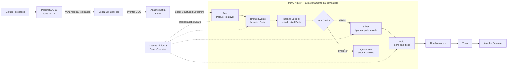
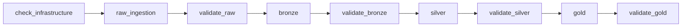

# DemandFlow Lakehouse

Lakehouse local de Engenharia de Dados que reproduz, com containers Docker, um fluxo moderno inspirado em Databricks e AWS: captura de mudanças no PostgreSQL, streaming com Kafka, processamento com Spark e Delta Lake, arquitetura Medalhão, consulta SQL e visualização analítica.

O projeto usa somente infraestrutura local. Ele foi desenhado para demonstrar CDC real, processamento incremental, idempotência, qualidade de dados, rastreabilidade e consumo analítico sem depender de uma implantação permanente em nuvem.

## O projeto

O DemandFlow representa uma empresa fictícia com lojas, produtos, promoções, pedidos, itens de pedido, estoque, movimentações de inventário e previsões de demanda. Mudanças operacionais são geradas no PostgreSQL e percorrem todo o Lakehouse até se tornarem métricas prontas para análise.

O pipeline permite responder perguntas como:

- qual é a receita por dia, loja e produto;
- quais produtos mais contribuem para vendas e unidades;
- quais posições de estoque estão saudáveis, abaixo do estoque de segurança ou em ruptura;
- quão próxima a previsão de demanda ficou do realizado;
- quais registros falharam nas regras de qualidade e por quê.

## Arquitetura do workflow



### Caminho do dado

1. O gerador simula vendas, reposições, alterações de preço, cancelamentos e atualizações de previsão no PostgreSQL.
2. O PostgreSQL publica as mudanças pelo WAL usando logical replication.
3. O Debezium converte `INSERT`, `UPDATE` e `DELETE` em eventos CDC e os envia aos tópicos Kafka `demandflow.public.*`.
4. O Spark Structured Streaming consome os tópicos, cria um `event_id` determinístico e grava a Raw em Parquet, preservando o evento técnico original e o checkpoint do streaming.
5. A Bronze materializa duas visões Delta: `Events`, com o histórico completo, e `Current`, com o último estado válido de cada chave após `MERGE` e tombstones de exclusão.
6. A Silver aplica tipos, contratos, chaves e regras de negócio. Registros válidos seguem para Silver; inválidos vão para Quarantine com os erros de qualidade e o payload de origem.
7. A Gold agrega a Silver em quatro produtos analíticos determinísticos.
8. O Hive Metastore cataloga as tabelas, o Trino oferece acesso SQL e o Superset consome exclusivamente a Gold.
9. O Airflow coordena as transformações e validações por meio de containers Spark efêmeros.

## Camadas de dados

| Camada | Formato | Responsabilidade |
| --- | --- | --- |
| Raw | Parquet | Captura técnica imutável dos eventos Kafka, com tópico, partição, offset, operação, LSN e payload Debezium. |
| Bronze Events | Delta Lake | Histórico deduplicado por `event_id`, preservando todas as mudanças recebidas. |
| Bronze Current | Delta Lake | Estado atual das oito entidades, reconstruível a partir de Bronze Events. |
| Silver | Delta Lake | Dados tipados, padronizados, íntegros e aprovados pelas regras de qualidade. |
| Quarantine | Delta Lake | Registros rejeitados, seus metadados e a lista de regras violadas. |
| Gold | Delta Lake | Agregações e métricas prontas para consulta analítica. |

Desde a Bronze, as tabelas usam transações ACID, `MERGE`, Change Data Feed e verificações de idempotência. Uma repetição sem mudança não deve criar linhas, arquivos ou versões Delta desnecessárias.

### Produtos Gold

| Tabela | Finalidade |
| --- | --- |
| `daily_sales` | Receita, pedidos e unidades realizadas por data e loja. |
| `product_sales` | Receita líquida e unidades vendidas por produto. |
| `inventory_health` | Estoque atual, estoque de segurança e classificação de saúde por loja e produto. |
| `forecast_accuracy` | Previsto versus realizado e métricas de erro por data, loja e produto. |

Somente pedidos nos estados `PAID`, `SHIPPED` e `DELIVERED` entram nas métricas realizadas de venda.

## Orquestração

A DAG [`demandflow_pipeline`](airflow/dags/demandflow_pipeline.py) possui nove tarefas sequenciais:



O Airflow 3 usa `CeleryExecutor`, Redis como broker e uma instância PostgreSQL separada para metadados. Cada tarefa de dados usa `DockerOperator` para iniciar a imagem `demandflow-spark:3.5.9` na rede do projeto. O paralelismo está limitado a uma tarefa para respeitar a capacidade da máquina local, e o cache Ivy persiste os artefatos Maven entre containers efêmeros.

## Armazenamento

O MinIO AIStor opera como armazenamento S3-compatible em nó único e usa volume Docker persistente. Os nomes dos buckets são:

- `demandflow-raw`;
- `demandflow-bronze`;
- `demandflow-silver`;
- `demandflow-gold`;
- `demandflow-quarantine`;
- `demandflow-checkpoints`.

O bootstrap é idempotente e cria uma identidade exclusiva para o pipeline com acesso limitado a esses buckets. A licença e as credenciais ficam em arquivos externos ao repositório e ao diretório sincronizado, apontados por `DEMANDFLOW_SECRETS_DIR`.

Mais detalhes estão em [`docs/aistor-migration.md`](docs/aistor-migration.md).

## Tecnologias

| Tecnologia | Versão no projeto | Papel |
| --- | --- | --- |
| Docker Compose | Runtime do host | Isolamento, rede, volumes, profiles e limites de recursos. |
| Python | Python 3 | Gerador de dados, jobs PySpark, validadores e automações auxiliares. |
| PostgreSQL | 16 Alpine | Fonte transacional e, em instância separada, metadados do Airflow. |
| Apache Kafka | 4.3.0 | Transporte durável de eventos em modo KRaft, sem ZooKeeper. |
| Debezium Connect | 3.6 | CDC PostgreSQL → Kafka. |
| Apache Spark | 3.5.9 / Scala 2.12 / Java 17 | Streaming, transformações e validações das camadas. |
| Delta Lake | 3.3.2 | Tabelas ACID, `MERGE`, CDF e time travel. |
| Hadoop AWS | 3.3.4 no Spark | Integração `s3a://` com o object storage. |
| MinIO AIStor | `RELEASE.2026-09-19T17-05-25Z` | Object storage local compatível com S3. |
| Apache Hive Metastore | 4.0.0 | Catálogo persistente das tabelas Delta. |
| Trino | 483 | Camada SQL sobre a Gold. |
| Apache Superset | 6.1.0 | Visualização e exploração analítica. |
| Apache Airflow | 3.3.2 | Orquestração com CeleryExecutor e DockerOperator. |
| Redis | 7 Alpine | Broker do CeleryExecutor. |
| PowerShell | Host Windows | Execução dos runbooks e validações isoladas. |

As versões são fixadas no [`compose.yaml`](compose.yaml), nos Dockerfiles e na DAG para evitar combinações incompatíveis entre Spark, Delta Lake e os conectores.

## Organização do repositório

```text
DemandFlow Lakehouse/
├── airflow/
│   └── dags/                    # DAG principal e smoke tests do Airflow
├── config/
│   ├── debezium/                # Template seguro do connector PostgreSQL
│   └── tables.json              # Contratos das oito entidades
├── docs/                        # Decisões e evidências técnicas
├── infra/
│   ├── airflow/                 # Imagem, inicialização e healthchecks
│   ├── hive-metastore/          # Imagem e configuração S3A
│   ├── minio/                   # Bootstrap e política de menor privilégio
│   ├── postgres/                # Schema, seed e configuração CDC
│   ├── spark/                   # Imagem Spark não privilegiada
│   ├── superset/                # Imagem, configuração e inicialização
│   └── trino/                   # Catálogo Delta
├── scripts/                     # Operação, recuperação e validações por bloco
├── src/
│   ├── generator/               # Gerador de mudanças transacionais
│   └── spark/
│       ├── raw/
│       ├── bronze/
│       ├── silver/
│       ├── gold/
│       └── smoke/
├── tests/                       # Testes estáticos de contratos e segurança
├── compose.yaml
└── requirements.txt
```

## Perfis de execução

| Profile | Serviços principais | Uso |
| --- | --- | --- |
| padrão | PostgreSQL e MinIO | Origem e armazenamento persistentes. |
| `cdc` | Kafka e Debezium | Captura de mudanças. |
| `processing` | Spark | Jobs manuais ou smoke tests. |
| `query` | Hive Metastore e Trino | Catálogo e acesso SQL. |
| `bi` | Hive, Trino e Superset | Consulta e visualização. |
| `orchestration` | Kafka, Debezium, PostgreSQL/Redis do Airflow e componentes Airflow | Execução orquestrada. |

## Execução local

### Pré-requisitos

- Windows com PowerShell;
- Docker Desktop com Docker Compose;
- Python 3 para o gerador e testes locais;
- licença MinIO AIStor Community disponível fora do repositório;
- arquivo `.env` local com os parâmetros não versionados;
- diretório externo de secrets indicado por `DEMANDFLOW_SECRETS_DIR`.

As credenciais do storage podem ser preparadas sem exibir seus valores:

```powershell
powershell -NoProfile -ExecutionPolicy Bypass -File scripts/initialize-storage-secrets.ps1
```

Para iniciar somente o armazenamento e garantir os buckets:

```powershell
powershell -NoProfile -ExecutionPolicy Bypass -File scripts/start-storage.ps1 -Bootstrap
```

### Validação recomendada em blocos

A stack completa consome mais recursos do que o notebook local suporta com estabilidade. O caminho recomendado é validar uma etapa por vez; os scripts iniciam apenas as dependências necessárias e encerram os serviços ao final:

```powershell
# PostgreSQL → Debezium → Kafka e gerador
powershell -NoProfile -ExecutionPolicy Bypass -File scripts/validate-cdc.ps1

# Kafka → Raw
powershell -NoProfile -ExecutionPolicy Bypass -File scripts/validate-raw-pipeline.ps1

# Raw → Bronze
powershell -NoProfile -ExecutionPolicy Bypass -File scripts/validate-bronze-pipeline.ps1

# Bronze → Silver + Quarantine
powershell -NoProfile -ExecutionPolicy Bypass -File scripts/validate-silver-pipeline.ps1

# Silver → Gold
powershell -NoProfile -ExecutionPolicy Bypass -File scripts/validate-gold-pipeline.ps1

# Gold → Hive → Trino → Superset
powershell -NoProfile -ExecutionPolicy Bypass -File scripts/validate-query-stack.ps1

# Infraestrutura e contrato da DAG Airflow
powershell -NoProfile -ExecutionPolicy Bypass -File scripts/validate-airflow-pipeline.ps1
```

Validação estática, sem executar o pipeline de dados:

```powershell
powershell -NoProfile -ExecutionPolicy Bypass -File scripts/validate-static-syntax.ps1
.venv\Scripts\python.exe -B -m unittest discover -s tests -p test_storage_migration.py -v
git diff --check
```

Não use `docker compose down -v` como forma de parada: a opção `-v` remove os volumes que guardam banco, tópicos, tabelas, checkpoints e metadados.

## Interfaces locais

Quando os respectivos serviços estiverem ativos, as portas publicadas ficam limitadas ao loopback do host:

| Serviço | Endereço |
| --- | --- |
| MinIO API | `http://127.0.0.1:9000` |
| MinIO Console | `http://127.0.0.1:9001` |
| Kafka | `127.0.0.1:9092` |
| Debezium Connect | `http://127.0.0.1:8083` |
| Hive Metastore | `127.0.0.1:9083` |
| Trino | `http://127.0.0.1:8080` |
| Airflow | `http://127.0.0.1:8081` |
| Superset | `http://127.0.0.1:8088` |

## Estado validado

Na validação funcional de referência de **14/10/2026**:

- a Raw continha 479 eventos únicos, incluindo o snapshot completo das oito entidades e eventos CDC;
- a Bronze preservou os 479 eventos e recompôs 461 registros atuais, sem eventos ausentes, extras ou divergentes;
- a Silver classificou os 461 registros como válidos, sem órfãos e sem registros em Quarantine nesse conjunto;
- a Gold produziu 289 linhas: 13 em `daily_sales`, 6 em `product_sales`, 18 em `inventory_health` e 252 em `forecast_accuracy`;
- Hive Metastore, Trino e Superset consultaram as quatro tabelas Gold com reconciliação das métricas;
- os sete componentes do Airflow ficaram saudáveis, a DAG foi importada sem erros e apresentou exatamente as nove tarefas esperadas;
- reexecuções das camadas não alteraram contagens nem versões Delta quando a origem permaneceu igual.

Essas quantidades descrevem o snapshot de teste e mudam quando o gerador cria novas transações. Elas não são constantes de negócio.

A tentativa de manter todos os serviços ativos ao mesmo tempo excedeu a capacidade do Docker Desktop no notebook. Por isso, a comprovação final foi feita por blocos isolados e repetíveis. O projeto está funcionalmente validado dessa forma, mas isso não equivale a teste de carga, alta disponibilidade ou certificação para produção.

## Segurança e limites do ambiente

- secrets, licença e credenciais ficam fora do Git e não são gravados no código;
- as imagens e scripts usam uma identidade S3 de menor privilégio, separada do administrador do storage;
- as portas são vinculadas a `127.0.0.1`, evitando exposição direta na rede externa;
- o worker Airflow monta o Docker socket e, portanto, possui privilégio elevado sobre o Docker local;
- Kafka, Trino e o tráfego interno operam sem TLS no ambiente local;
- MinIO funciona em nó único, sem alta disponibilidade e sem substituir uma estratégia de backup;
- o Superset usa metadados SQLite e rate limiting em memória, adequados ao teste local de instância única, não a uso multiusuário;
- o Trino local não possui autenticação nem TLS;
- as validações provam o caminho funcional exercitado, não a ausência de CVEs nas imagens.

Antes de qualquer exposição externa ou uso multiusuário, são necessários TLS, autenticação no Trino/Kafka, banco de metadados suportado para o Superset, gestão centralizada de secrets, backups e dimensionamento de recursos.

## Princípios preservados

- Raw é imutável;
- Kafka transporta eventos, mas não substitui o Lakehouse;
- Bronze Events e Bronze Current têm responsabilidades diferentes;
- ordenação técnica prioriza LSN e metadados Kafka;
- reprocessamento precisa ser idempotente;
- registros inválidos não desaparecem: seguem para Quarantine;
- Superset consulta a Gold por meio do Trino;
- limitações do notebook alteram a estratégia de execução, não o desenho lógico da arquitetura.

